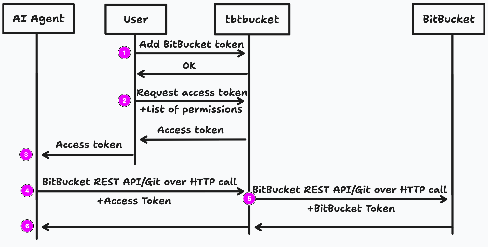
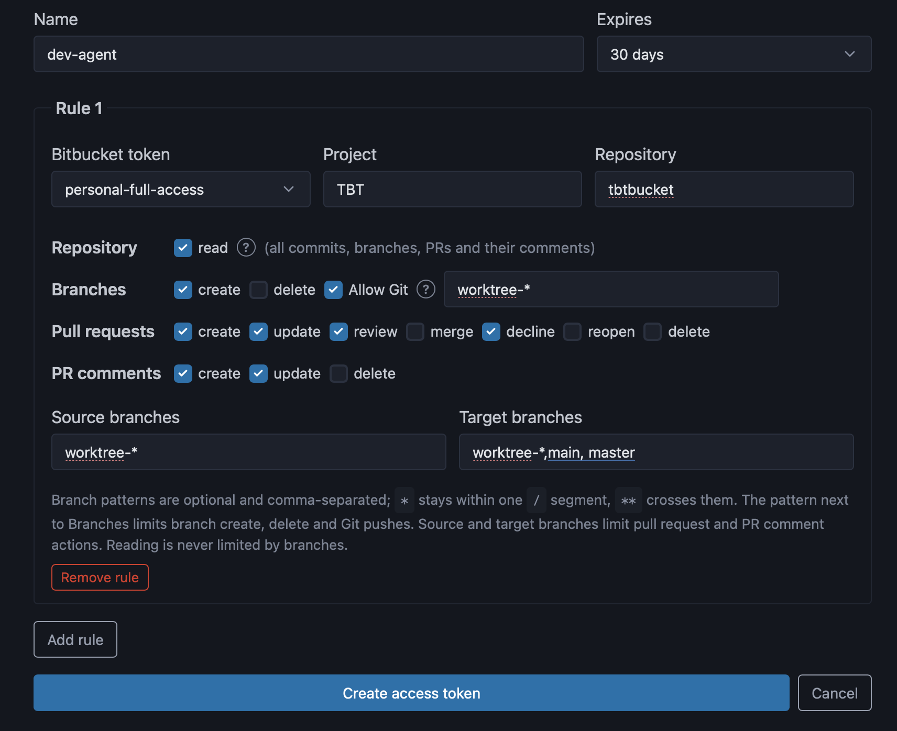

# `tbtbucket`

[](https://madebyhuman.iamjarl.com)

Missing fine-frained access tokens for Bitbucket.

- [`tbtbucket`](#tbtbucket)
  - [Motivation](#motivation)
  - [How it works](#how-it-works)
  - [Usage](#usage)
  - [DBFL](#bdfl)

## Motivation

> [!TIP]
> The software security system is only as secure as its weakest components.

> [!IMPORTANT]
> The principle of least privilege (PoLP) requires every user, program, or process to receive only the minimum access rights and resources needed to complete a task.

When I assign a task to the agent, I don't want it to have write access to the entire repo or multiple repos unless it really needs it.
GitHub has a wonderful feature called [fine-grained personal access tokens](https://github.com/settings/personal-access-tokens): they allow you to precisely specify what permissions the access token has, what it can do, and what it can't do.
You can even choose a separate repo and allow only a subset of actions.

Unfortunately, Bitbucket doesn't offer fine-grained access tokens.
It only lets you generate a read-only, write, or admin HTTP token for your account.
This token will have the same access scope as your account.
Alternatively, it also allows you to generate a repo-wide token.
You may have write access to the repo but not permission to generate repo HTTP tokens.

This project aims to solve this problem.
The `tbtbucket` proxy is placed between your agents or any other Bitbucket REST API client and intercepts REST API requests or Git (over HTTP) operations.
It verifies the request by checking the provided access token for sufficient permissions.
Read more about it below.

## How it works



1. First, the user generates a real personal BitBucket token on their BitBucket profile page and saves it in the proxy settings (there is a web app for that).
2. Next, the user requests (via the web app or the proxy API) an access token for their agent.
   When requesting an access token, the user specifies allowed permissions, resources, and which Bitbucket token to use.
   The user can add many permission rules to one access token.
3. The copied access token is provided to the agent in any suitable way: environment variable, configuration file, etc.
  From the outside, this token is no different from a Bitbucket or GitHub authorization bearer token.
4. The agent/`git`/API client uses this token when making BitBucket-like REST API calls to the proxy.
5. The proxy checks the request against permissions provided by the access token. If the request is allowed, it is forwarded to the real BitBucket server.
6. The Bitbucket response is sent back to the agent/`git`/API client.

The permissions configuration is highly flexible.
The user can configure which branches are allowed for pushing/creating PRs.
Better to see once than hear a hundred times:



## Usage

The proxy is configured through environment variables:

| Variable | Required | Description |
| --- | --- | --- |
| `FQATB_ENCRYPTION_KEY` | yes | 32-byte master key as 64 hex characters, for example from `openssl rand -hex 32`. The database and session encryption keys and the access token signing key are derived from it. |
| `FQATB_BITBUCKET_URL` | yes | Base URL of the Bitbucket Data Center server that requests are forwarded to, such as `https://bitbucket.example.com`. |
| `FQATB_BITBUCKET_CA_CERT` | no | Path to a PEM file with the CA certificates that issued the Bitbucket server's certificate, for a server whose certificate the system does not trust. When set, only these CAs are trusted for Bitbucket. |
| `FQATB_LISTEN_ADDR` | no | Address to listen on, `127.0.0.1:8080` by default. |
| `FQATB_TLS_CERT` | no | Path to the PEM certificate chain, leaf certificate first. Set together with `FQATB_TLS_KEY` to serve HTTPS. |
| `FQATB_TLS_KEY` | no | Path to the PEM private key (PKCS#8, PKCS#1 or SEC1) for `FQATB_TLS_CERT`. |
| `FQATB_DATABASE_URL` | no | SQLite database URL, `sqlite://fqatb.db` by default. The file is created and migrated on start-up. |
| `FGATB_LOGGING` | no | Log filter in the [`EnvFilter` syntax](https://docs.rs/tracing-subscriber/latest/tracing_subscriber/filter/struct.EnvFilter.html#directives), `trace` by default. For example, `info` or `info,fqatb_proxy=debug`. |

```bash
FQATB_ENCRYPTION_KEY=$(openssl rand -hex 32) FQATB_BITBUCKET_URL=https://bitbucket.example.com cargo run
```

Webapp instructions, tokens generation, and more are covered in [`USAGE.md`](./docs/USAGE.md).

## BDFL

Have you heard of [BDFL](https://en.m.wikipedia.org/wiki/Benevolent_dictator_for_life)?

TL;DR:

> **Benevolent dictator for life (BDFL)** is a title given to a small number of open-source software development leaders, typically project founders who retain the final say in disputes or arguments within the community.

For the `tbtbucket` project, the BDFL is [@TheBestTvarynka (Pavlo Myroniuk)](https://github.com/TheBestTvarynka), the original creator of Grafily.
